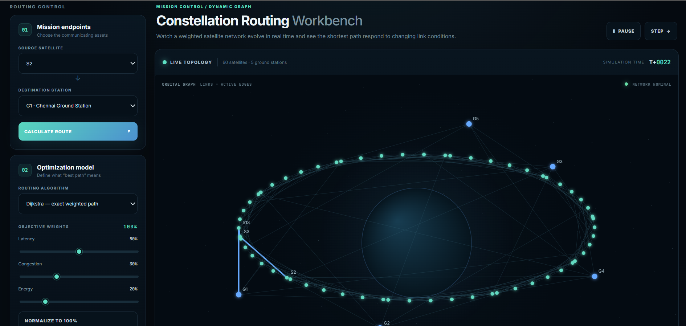
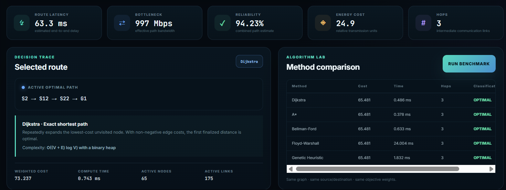
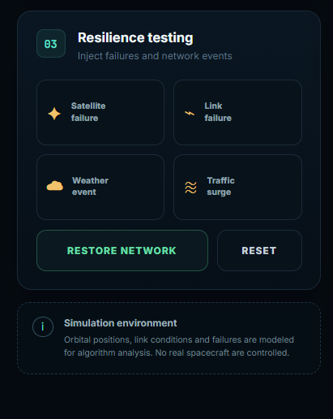
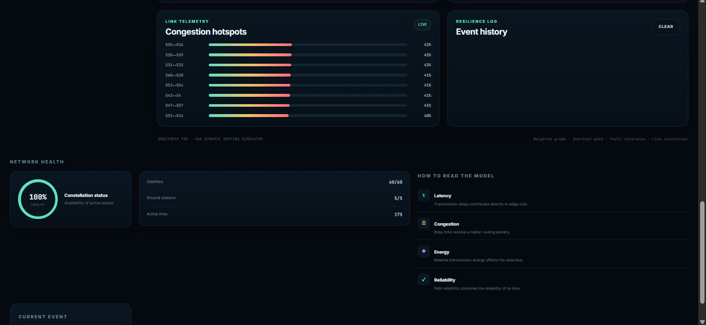

# OrbitMesh — Dynamic Satellite Routing Lab

A student-built **Design and Analysis of Algorithms (DAA)** project that models a satellite constellation as a dynamic weighted graph and compares route-finding methods under changing link conditions and simulated failures.

> **Simulation only:** OrbitMesh does not connect to real satellites, use live telemetry, or control spacecraft. Orbital motion and network metrics are synthetic and intended for algorithm demonstrations.

## Features

- Interactive constellation visualization with 60 simulated satellites and 5 ground stations
- Dynamic edge weights based on simulated geometry, latency, congestion, and energy
- Multi-objective routing cost with adjustable weights
- Dijkstra, A*, Bellman–Ford, and Floyd–Warshall implementations
- A deterministic multi-weight candidate heuristic labelled **Genetic Heuristic** in the UI (not a conventional genetic algorithm)
- Route metrics: estimated latency, bottleneck bandwidth, reliability estimate, energy cost, hop count, and weighted cost
- Benchmark table for comparing methods on the current graph
- Simulated satellite/link failures, weather, congestion, and network recovery
- Live congestion telemetry, event history, and network-health indicators

## Project structure

```text
OrbitMesh-Dynamic-Satellite-Routing-Lab/
├── backend/
│   ├── app.py                 # Flask API, graph model, routing algorithms, simulation
│   └── requirements.txt       # Python dependencies
├── frontend/
│   ├── index.html             # Dashboard markup
│   ├── styles.css             # Responsive dark mission-control UI
│   └── app.js                 # API calls, visualization, interactions
├── docs/
│   ├── API.md                 # REST endpoint reference
│   ├── DAA_REPORT_GUIDE.md    # Algorithm/report notes
│   └── screenshots/           # Example application screenshots
├── .gitignore
├── run_backend.bat
├── run_backend.sh
├── run_frontend.bat
└── run_frontend.sh
```

## Requirements

- Python 3.10 or newer recommended
- pip
- A modern browser (Chrome, Edge, Firefox, or Safari)

The backend dependencies are listed in `backend/requirements.txt` (Flask and Flask-CORS). No Node.js build step is required.

## Run locally

Run the backend and frontend in **two separate terminals**.

### 1. Start the backend

**Windows (PowerShell):**
```powershell
cd backend
py -m venv .venv
.venv\Scripts\Activate.ps1
python -m pip install -r requirements.txt
python app.py
```

If PowerShell blocks environment activation, use Command Prompt and run:
```bat
.venv\Scripts\activate.bat
```

**macOS / Linux:**
```bash
cd backend
python3 -m venv .venv
source .venv/bin/activate
python -m pip install -r requirements.txt
python app.py
```

The API runs at `http://127.0.0.1:5000`.

### 2. Start the frontend

Open a second terminal at the project root.

**Windows:**
```powershell
cd frontend
py -m http.server 5500
```

**macOS / Linux:**
```bash
cd frontend
python3 -m http.server 5500
```

Open `http://127.0.0.1:5500` in your browser. Use the local HTTP server rather than opening `index.html` directly so browser API requests work as expected.

### Optional launch scripts

The repository also includes `run_backend.bat`, `run_backend.sh`, `run_frontend.bat`, and `run_frontend.sh`. Review scripts before running them. The backend launcher creates a virtual environment and installs dependencies; the frontend launcher serves the static files.

## Quick demo

1. Start both servers and wait for the **API ONLINE** indicator.
2. Select a source satellite and destination ground station.
3. Choose a routing algorithm and adjust the latency, congestion, and energy weights.
4. Click **Calculate Route** and inspect the highlighted path and metrics.
5. Run the benchmark to compare the algorithms on the same graph.
6. Trigger a satellite failure or link failure and observe route re-optimization.
7. Try a weather or congestion event, then use **Restore Network** or **Reset** to return to a baseline scenario.

## Routing objective

For an edge \(e\), the implementation uses a weighted score of the form:

`cost(e) = w_latency × latency(e) + w_congestion × 2.2 × congestion(e) + w_energy × energy(e)`

The weights are supplied by the user interface. The metrics are synthetic, and the terms are not formally normalized; therefore, interpret the weighted score as an educational comparison objective rather than a physically calibrated unit.

## Algorithm notes and limitations

- **Dijkstra:** finds an optimal path for non-negative edge weights. This implementation uses a linear scan to select the next node, so its implementation-level complexity is approximately `O(V² + E)`, not binary-heap `O((V + E) log V)`.
- **A\*:** uses a geometry-based heuristic. Admissibility/consistency for the combined cost function is not proven, so optimality is not guaranteed for every possible configuration.
- **Bellman–Ford:** repeated edge relaxation; useful as a comparison baseline.
- **Floyd–Warshall:** all-pairs dynamic programming; useful for dense/small graph comparisons.
- **Genetic Heuristic:** despite its UI label, the current implementation compares paths generated from several fixed weight configurations. It does not implement genetic selection, crossover, or mutation.
- Runtime measurements are machine- and run-dependent; benchmark results should be treated as observations, not universal performance claims.

More details: [`docs/API.md`](docs/API.md) and [`docs/DAA_REPORT_GUIDE.md`](docs/DAA_REPORT_GUIDE.md).

## Screenshots

### Constellation workbench


### Route and algorithm benchmark


### Resilience testing


### Network health and congestion telemetry


## API overview

Base URL: `http://127.0.0.1:5000/api`

| Method | Endpoint | Purpose |
|---|---|---|
| GET | `/health` | Backend health |
| GET | `/network` | Current graph and simulation state |
| GET | `/algorithms` | Algorithm metadata |
| POST | `/route` | Calculate a route |
| POST | `/benchmark` | Compare routing methods |
| POST | `/event` | Inject a simulated event |
| POST | `/simulate` | Advance simulation ticks |
| POST | `/reset` | Restore the baseline network |

See [`docs/API.md`](docs/API.md) for request examples.

## Academic context

This project demonstrates graph modelling, weighted shortest-path algorithms, complexity comparison, simulation, and fault-aware re-routing. It is suitable as a DAA learning/demo project and is not an operational satellite-network design.

## Repository contents

This repository intentionally contains source code and project documentation only. Python virtual environments, caches, editor settings, and local runtime artifacts are excluded by `.gitignore`.
